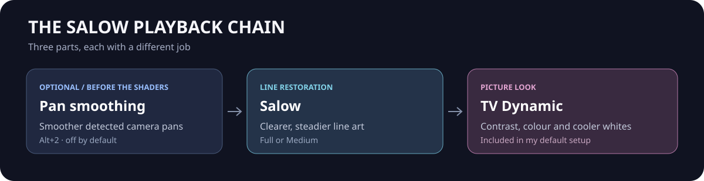
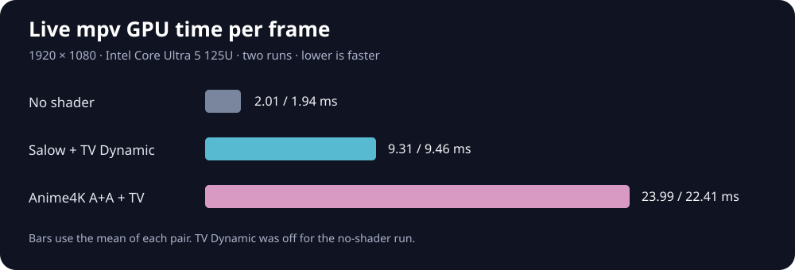

# Salow



**Salow** is my mpv setup for anime: a line-restoration shader, the **TV Dynamic** picture look, and optional **pan smoothing**. It is designed around native 1080p playback on laptop integrated graphics.

- **Salow** restores lines with a small convolutional network and includes a temporal step intended to reduce shimmer on still edges. Salow Medium offers a smaller network.
- **TV Dynamic** gives the picture a TV-inspired look, adding contrast and vibrance with a slightly cool white point. It runs after Salow and is part of my default setup.
- **Pan smoothing** is an optional video filter in my mpv configuration. It looks for camera pans and uses motion interpolation on detected pans. It starts off; **Alt+2** turns it on or off.

The aim is clean, even lines while preserving detail and colour. Results, cost and artifacts depend on the video and hardware.

## The shaders

| File | What it is | GPU time\* |
|---|---|---|
| `shaders/salow.hook` | **Salow**: 4-layer network plus thin-line and steady steps. Best quality. | ~6.7 ms |
| `shaders/salow-medium.hook` | **Salow Medium**: 3-layer network with the same extra steps. About 22% cheaper, slightly less exact on fine edges. | ~5.2 ms |
| `shaders/tv-dynamic.glsl` | **TV Dynamic**: optional picture mode like a TV's "Dynamic" preset (gentle S-curve, vibrance, slightly cool white), with bounded colour adjustments. Runs after Salow. | very small (one pass, per pixel) |
| Anime4K A+A (for comparison) | Clamp_Highlights + Restore_CNN_M + Restore_CNN_S | ~23 ms |

\* Shader time per 1080p frame on an **Intel Core Ultra 5 125U** (Intel integrated graphics) in **power-saver mode**,
measured offscreen with libplacebo/Vulkan. Your numbers will differ by GPU and power mode. In real mpv playback
on the same laptop, the total GPU time per frame (including mpv's own work and TV Dynamic) was 9.3 ms with Salow
against 23 ms with A+A, with no dropped frames. Salow Medium has not been timed in live mpv yet; its figure comes
from the offscreen runs.

## Comparisons



These are **total mpv GPU times**, including mpv's own rendering. The test used two 20-second runs after a 5-second warm-up on an Intel Core Ultra 5 125U in power-saver mode, with gpu-next/Vulkan, interpolation, and 1080p input and output. Salow and A+A used TV Dynamic; the no-shader run did not. All runs recorded zero dropped frames. The bars show the mean of the two runs; the labels show each measurement. This is one clip on one machine, not a performance guarantee. Pan smoothing was not part of this comparison.

### Line detail and similarity to Anime4K A+A

Measured on 4 held-out clips (bright, dark, close-up face, busy detail), 12 frames each. Lower is closer to A+A.

| | Salow | Salow Medium |
|---|---|---|
| Mean difference from A+A (0–255 code values), face / dark clip | 0.29 / 0.32 | 0.38 / 0.39 |
| Mean difference on edges, face / bright clip | 4.1 / 4.0 | 5.7 / 5.9 |
| Thin-line depth (A+A: 14.8 face, 12.6 bright) | 16.6 / 13.7 | 15.9 / 12.7 |

In these samples, Medium is less close to A+A on fine edges. Line depth is not an error score: the target varies by clip, and a higher number means a darker line, not necessarily a better result. Choose the version that works best on your system.

A separate offscreen test measured line shimmer and thin-line depth in five held-out 48-frame clips on the same Intel GPU. The current Salow was called **Salow Steady** in those notes; the earlier Salow is the version without its thin-line and temporal steps:

| Measurement | Anime4K A+A | Earlier Salow | Current Salow |
|---|---:|---:|---:|
| Still clip: edge shimmer (code values; lower is less frame-to-frame change) | 0.468 | 0.533 | 0.350 |
| Dark clip: edge shimmer (code values; lower is less) | 0.603 | 0.607 | 0.463 |
| Dark clip: thin-line depth (code values; higher is darker) | 10.58 | 7.31 | 9.83 |

These differences were measured on selected areas and clips. The shimmer changes are small, and visibility was not established. The underlying captures and runner were removed during project cleanup, so these figures are retained from the original test notes; no before-and-after images are presented here. See [comparison notes](docs/comparison-notes.md).

## TV Dynamic

TV Dynamic is the picture look I pair with Salow. Its single pass applies an S-curve to brightness, gives less-saturated colours a stronger vibrance boost, and adds a slightly cool white point. It can also be used without Salow. The shader limits colour gain and clamps its output, but the look changes colour and contrast by design; it is not a calibrated display profile. The visual effect and cost have not been separately measured in the timing comparison above.

## Pan smoothing

Pan smoothing is part of the optional [mpv configuration](mpv-config/), not a shader. It estimates motion at reduced resolution and uses VapourSynth MVTools interpolation when the motion resembles a camera pan. Other scenes use a frame-mixing path. For approximately 23.976 or 24 fps sources it outputs approximately 59.94 or 60 fps; 25 fps becomes 62.5 fps. Other source frame rates pass through without this processing.

It is **off by default** and toggled with **Alt+2** in the configuration package. It requires an mpv build with VapourSynth, VapourSynth MVTools and NumPy. It can increase CPU and GPU work, and motion estimation can produce artifacts. Its compatibility and performance depend on the installed versions, hardware and video; no universal smoothness or timing claim is implied.

## Requirements

- **mpv with `vo=gpu-next`** (libplacebo). The steady step uses a storage texture that persists between frames,
  which the old `vo=gpu` renderer does not support. Tested with mpv 0.42 / libplacebo 7.3xx on Vulkan.
- **Native 1080p video on a 1080p output.** Salow works on the full-resolution picture before scaling. The
  frame memory covers 1920×1080; outside it the steady step simply switches off. For lower-resolution sources,
  use an upscaler such as Anime4K instead.

## Downloads and installation

The main download is the shader itself: [Salow](shaders/salow.hook). [Salow Medium](shaders/salow-medium.hook) is a smaller alternative, and [TV Dynamic](shaders/tv-dynamic.glsl) is an optional look. Download whichever files you want from the repository or release.

On Linux, install Git and mpv using your distribution's package manager, then run:

```sh
git clone https://github.com/Titik-03/salow.git && cd salow && ./install.sh
```

This installs the three shader files without changing your existing mpv settings. You can also install them manually:

1. Copy the files from `shaders/` into your mpv shaders folder:
   - Linux / macOS: `~/.config/mpv/shaders/`
   - Windows: `%APPDATA%\mpv\shaders\`
2. Add to `mpv.conf`:

   ```ini
   vo=gpu-next
   glsl-shaders="~~/shaders/salow.hook"
   ```

   With the TV Dynamic look:

   ```ini
   glsl-shaders="~~/shaders/salow.hook:~~/shaders/tv-dynamic.glsl"
   ```

3. Optional keys in `input.conf`:

   ```
   CTRL+1 no-osd change-list glsl-shaders set "~~/shaders/salow.hook"; show-text "Salow"
   CTRL+2 no-osd change-list glsl-shaders set "~~/shaders/salow-medium.hook"; show-text "Salow Medium"
   CTRL+5 no-osd change-list glsl-shaders toggle "~~/shaders/tv-dynamic.glsl"; show-text "TV Dynamic"
   CTRL+0 no-osd change-list glsl-shaders clr ""; show-text "Shaders off"
   ```

   Ctrl+1 and Ctrl+2 replace the whole shader list, so press Ctrl+5 again afterwards if you want TV Dynamic.

### Optional: my mpv configuration

The `mpv-config/` folder contains my player setup, including Salow + TV Dynamic, uosc, Anime4K A+A for lower-resolution video, playback controls and optional pan smoothing. To install it on Linux, run:

```sh
./install-config.sh
```

The installer only works if the destination mpv configuration directory does not already exist; rename or back up an existing configuration first. It installs all three shaders as well. This setup reflects my Intel/VA-API, PipeWire, 60 Hz touchscreen system and may need adjustments for yours. Pan smoothing is off by default and requires an mpv build with VapourSynth, VapourSynth with MVTools, and NumPy; Alt+2 toggles it. Alt+1 toggles frame mixing.

The audio impulse responses are not included because their redistribution terms are not established. Without them the audio cycle starts with native sound. To use the X-Fi, Atmos or Razor options, place your own `xfi-crystalizer.wav`, `dolby-atmos.wav` or `razor-surround.wav` in the mpv `irs/` directory. X-Fi starts by default when its file is present; Alt+A cycles through available modes. The uosc helper binaries are not included, so its clipboard and subtitle download features are unavailable. See [configuration credits](mpv-config/README.md).

### Tuning TV Dynamic

The look has three parameters you can set in `mpv.conf`, for example:

```ini
glsl-shader-opts=tv_contrast=0.30,tv_vibrance=0.45,tv_cool=0.025
```

| Parameter | Range | Default | Effect |
|---|---|---|---|
| `tv_contrast` | 0–1 | 0.30 | S-curve strength (deeper shadows, brighter highlights) |
| `tv_vibrance` | 0–1.5 | 0.45 | Boosts dull colours more than already-strong ones |
| `tv_cool` | 0–0.1 | 0.025 | Cooler white point, scaled by brightness so blacks stay neutral |

## How it works

Salow is a small convolutional network (3×3 convolutions with 4 channels, CReLU), trained to reproduce Anime4K A+A's
output at native 1080p. It uses Anime4K's layer layout and starting weights and is fine-tuned on anime frames with
A+A as the teacher. The last layer is made 10% stronger for slightly crisper lines. A+A's de-ringing step
(Clamp_Highlights) is folded into the last pass, which saves two passes.

After the network, the last pass also:

1. **Thin-line depth:** finds thin dark ridges with a local maximum below about 150/255 and adds a bounded darkening correction. In one tested clip the result exceeded A+A's measured depth.
2. **Steady:** keeps the previous frame's correction in a storage texture. Where both the source pixel and the
   correction changed by less than about 1–3 code values, it averages the two (60% weight at most). The gate is intended to leave moving areas alone.

Things we tried that did **not** make Salow faster without changing its output, on this Intel iGPU:
half precision (`mediump`, ignored by the driver), reading textures with `texelFetch`, sharing the 5×5
neighbourhood reads, and compute-shader versions of the passes.

## Credits and license

The shaders and project code are available under the MIT License; see [LICENSE](LICENSE). The optional mpv configuration includes third-party components under their own licenses; see [configuration credits](mpv-config/README.md).

The network layout, the Clamp_Highlights statistics and the starting weights come from
[Anime4K](https://github.com/bloc97/Anime4K) by bloc97 (MIT). Its notice is kept in every shader file.
If you like these shaders, go star Anime4K too.
