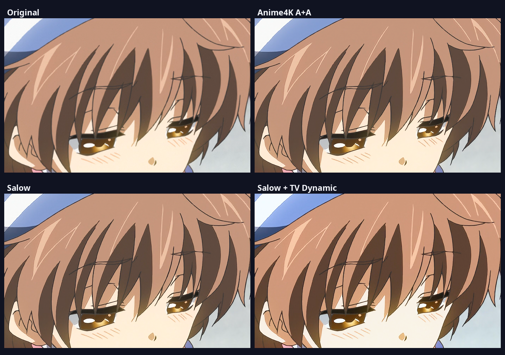
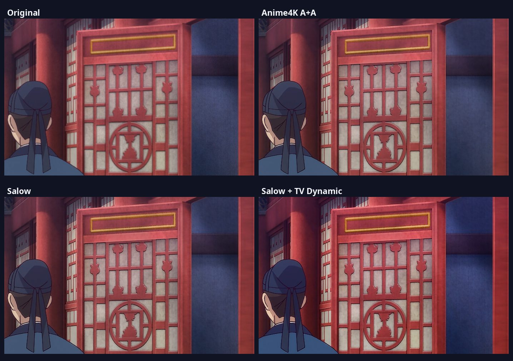

# Salow


My mpv shaders and playback setup for **native 1080p anime** on integrated graphics.

| Part | What it does |
|---|---|
| **[Salow](shaders/salow.hook)** | Restores line art with a four-layer network and a temporal step to reduce still-edge shimmer. |
| **[Salow Medium](shaders/salow-medium.hook)** | A smaller three-layer alternative. |
| **[TV Dynamic](shaders/tv-dynamic.glsl)** | Adds contrast, vibrance and cooler whites. Part of my default look. |
| **Pan smoothing** | Optional camera-pan interpolation in the mpv configuration. **Alt+2**, initially off; remembers your choice. |

## Install

Use **mpv with `vo=gpu-next`**; the tested path is Vulkan at 1920×1080. Install mpv and Git through your Linux package manager, then choose **one** setup:

**Shaders only — keep your current mpv setup:**

```sh
git clone https://github.com/Titik-03/salow.git && cd salow && ./install.sh
```

Add or update these settings in `mpv.conf` (normally `~/.config/mpv/mpv.conf`):

```ini
vo=gpu-next
glsl-shaders="~~/shaders/salow.hook:~~/shaders/tv-dynamic.glsl"
```

Use `salow-medium.hook` for Medium, or remove the TV Dynamic path for the natural look. The installer respects `XDG_CONFIG_HOME` and refuses to overwrite existing shader files.

**My full mpv setup — shaders, controls, uosc and optional pan smoothing:**

```sh
git clone https://github.com/Titik-03/salow.git && cd salow && ./install-config.sh
```

If already cloned, run the chosen installer from that folder. The full installer automatically moves your old configuration into a dated backup beside the mpv folder, then installs the new setup. It preserves supplied audio impulse responses and saved toggle choices. Graphics, hardware decoding and audio output are selected automatically. The motion settings target a 60 Hz display. [Controls, dependencies and audio setup](mpv-config/README.md).

Prefer manual installation? Download the shader files from [Releases](https://github.com/Titik-03/salow/releases), place them in your mpv `shaders/` folder and use the settings above.

## Image comparisons

Same frame, identical crops: **Original → Anime4K A+A → Salow → Salow + TV Dynamic**. Open the full-resolution images to inspect the detail.

### Clannad: After Story



[Full-scene comparison](docs/comparisons/clannad-scene.webp) · [Original](docs/comparisons/clannad-original.webp) · [Anime4K A+A](docs/comparisons/clannad-anime4k.webp) · [Salow](docs/comparisons/clannad-salow.webp) · [Salow + TV Dynamic](docs/comparisons/clannad-salow-tv.webp)

### The Apothecary Diaries



[Full-scene comparison](docs/comparisons/kusuriya-scene.webp) · [Original](docs/comparisons/kusuriya-original.webp) · [Anime4K A+A](docs/comparisons/kusuriya-anime4k.webp) · [Salow](docs/comparisons/kusuriya-salow.webp) · [Salow + TV Dynamic](docs/comparisons/kusuriya-salow-tv.webp)

Offscreen FFmpeg/libplacebo renders. Stills cannot show shimmer or pan smoothing. The A+A reference uses Restore M + S, not the larger HQ configuration. [Render details](docs/comparisons/README.md).

## Performance


Historical results on an Intel Core Ultra 5 125U, power-saver, gpu-next/Vulkan, 1080p. Two runs of one clip; all recorded zero dropped frames. Salow and A+A include TV Dynamic; pan smoothing was off. These are total GPU rendering times, not a guarantee for other hardware. [Test notes](docs/comparison-notes.md).

## TV Dynamic and pan smoothing

**TV Dynamic** is a separate picture-look shader that runs after Salow. Adjust its contrast, vibrance and white-point settings to taste; it changes colour by design. [Tuning and technical details](docs/technical-details.md#tuning-tv-dynamic).

**Pan smoothing** requires mpv with VapourSynth support, VapourSynth MVTools and NumPy. Detected pans are interpolated: 23.976/24 fps becomes 59.94/60 fps; 25 fps becomes 62.5 fps. It increases processing work and may introduce motion artifacts. It starts off and remembers your **Alt+2** choice across restarts. Alt+1 remembers frame mixing; Alt+3 remembers Original / Atmos / X-Fi audio (initially X-Fi).

## Credits

Salow uses [Anime4K](https://github.com/bloc97/Anime4K)'s network layout, starting weights and clamp statistics. Its MIT notice is preserved. [Project license](LICENSE) · [Third-party licenses](mpv-config/README.md#third-party-components) · [Technical details](docs/technical-details.md).
